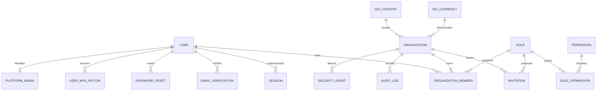

# Database relationships

All tenant relations are constrained by `organization_id` plus assignment triggers where a nullable global role template prevents a simple composite foreign key. Deletion is restrictive for identity/history and cascading only for ephemeral credentials, tenant invitations, tenant custom roles, and role mappings.
